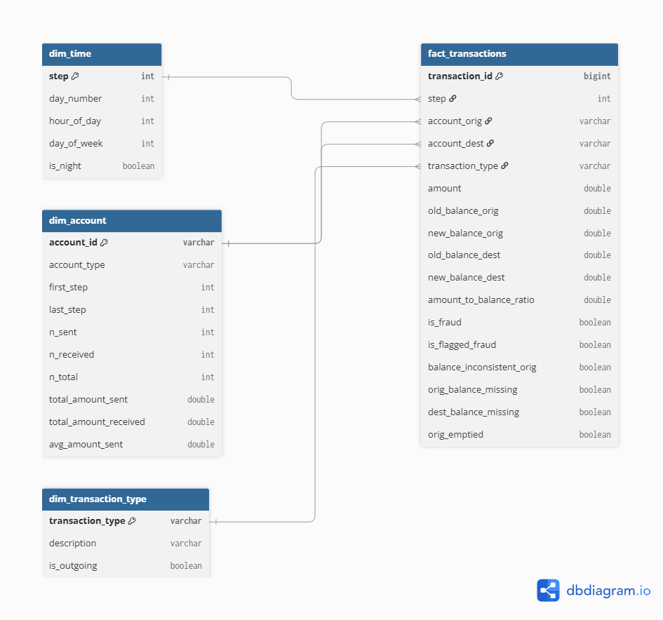

# AML Transaction Monitoring

End-to-end financial crime detection pipeline on 6.3M mobile money
transactions: dimensional data warehouse, SQL-based typology detection,
ML classification, and a Power BI monitoring dashboard.

**Status:** in development — Phase 1 (data warehouse) complete.

## Data

[PaySim](https://www.kaggle.com/datasets/ealaxi/paysim1) — 6,362,620
synthetic mobile money transactions spanning 743 hourly steps (~31 days),
with 8,213 labelled fraudulent (0.129%).

The dataset is not committed to this repository. Download it from Kaggle
and place the CSV in `data/raw/`.

## Stack

DuckDB (SQL warehouse) · Python (pandas, scikit-learn) · Power BI

## Data model

The warehouse follows a three-layer architecture:

| Layer | Purpose | Location |
|---|---|---|
| **Raw** | Immutable copy of the source CSV | `sql/01_raw/` |
| **Staging** | Cleaned, standardised, quality-flagged | `sql/02_staging/` |
| **Analytics** | Star schema for querying and BI | `sql/03_analytics/` |

The analytics layer is a star schema: `fact_transactions` (one row per
transaction) joined to `dim_time`, `dim_account` and
`dim_transaction_type`. `dim_account` is a role-playing dimension —
it joins to the fact table twice, as sender and as recipient.



## Project structure

```
sql/
├── 01_raw/ # load CSV into DuckDB, no transformation
├── 02_staging/ # cleaning, type casting, derived flags
├── 03_analytics/ # star schema (fact + dimensions)
├── 04_detection/ # AML typology rules (Phase 3)
└── quality_checks.sql

src/
├── build_warehouse.py # runs all SQL layers in order
└── run_quality_checks.py # validates the built warehouse

notebooks/
├── 01_explore_source.ipynb # source data exploration
└── 02_validate_warehouse.ipynb # warehouse validation and findings
```

## How to run

```bash
pip install -r requirements.txt
python src/build_warehouse.py
python src/run_quality_checks.py
```

The warehouse is a build artefact (`aml.duckdb`, ~900 MB) and is not
committed — it is fully reproducible from the SQL files.
